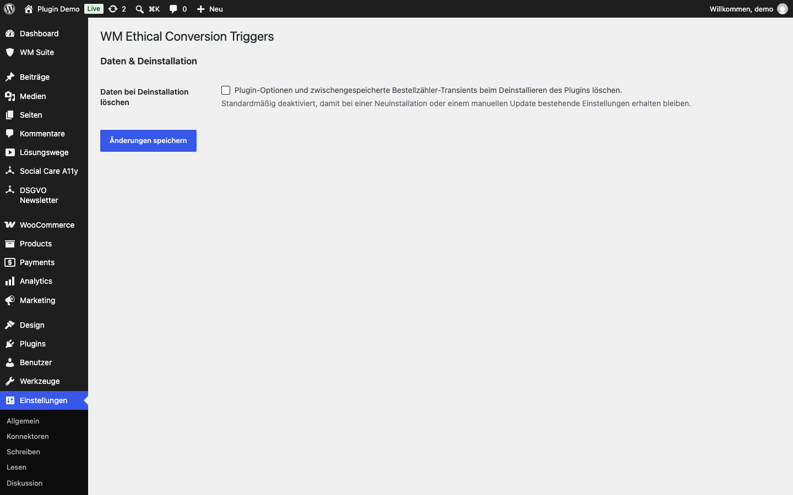
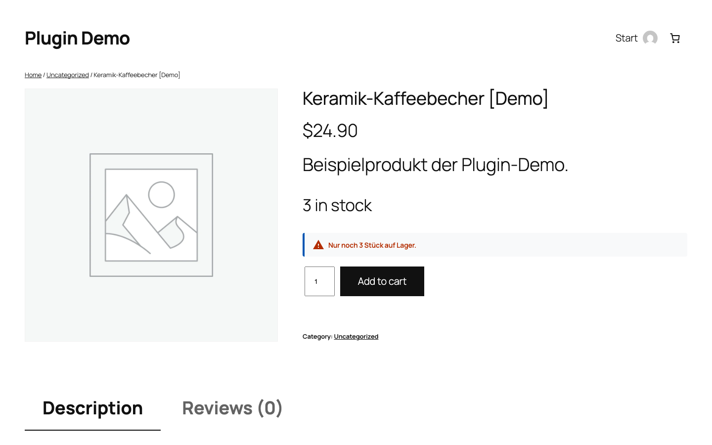

# WM Ethical Conversion Triggers (Deutsche Dokumentation)

<p align="center">
  <a href="README.md"></a>
  <a href="README.de.md"></a>
  <a href="README.es.md"></a>
</p>

<p align="center">
  
  <a href="https://wordpress.org"></a>
  <a href="https://php.net"></a>
  
  <a href="https://www.gnu.org/licenses/gpl-2.0.html"></a>
</p>

> **Bestell- und Niedrigbestandshinweise für WooCommerce-Produktseiten — ausschließlich aus echten bezahlten HPOS-Bestellungen und verwaltetem Lagerbestand**  
> **Plugin-Seite:** [https://arnoldwender.com/wordpress-plugins/wm-ethical-conversion-triggers/](https://arnoldwender.com/wordpress-plugins/wm-ethical-conversion-triggers/)  
> **Mit einem agentischen Workflow entwickelt:** entstanden mit KI-Coding-Agenten. Prüfen und testen Sie es wie jeden fremden Code, bevor Sie es produktiv einsetzen.  
> **Support & Haftung:** Kein Support (Zero Support) — reproduzierbare Bugs ausschließlich über [GitHub Issues](https://github.com/arnoldwender/wm-wp-ethical-conversion-triggers/issues) · kein privater Support · OHNE GEWÄHR („AS IS“) / keine Haftung ([SUPPORT.md](SUPPORT.md))

---

## Screenshots

!WM Ethical Conversion Triggers Banner

| Einstellungen > Ethische Hinweise | WooCommerce-Produktseite |
|---|---|
|  |  |

---

## Was das Plugin genau leistet

Zwei Hinweise auf der WooCommerce-Produktseite (`woocommerce_before_add_to_cart_form`), jeweils unter einer strikten Bedingung:

| Hinweis | Wird nur angezeigt, wenn |
|---|---|
| *„%d Bestellung(en) dieses Artikels in den letzten 7 Tagen.“* | `N > 0`: eindeutige **bezahlte** Bestellungen (`wc_get_is_paid_statuses()`, standardmäßig `processing` und `completed`) mit diesem Produkt in den letzten 7 Tagen, ohne Erstattungen (`stats.parent_id = 0`), abgefragt über vorbereitete SQL-Abfragen auf `{prefix}wc_order_product_lookup` und `{prefix}wc_order_stats` (HPOS-kompatibel, ohne Postmeta) |
| *„Nur noch %d Stück auf Lager.“* | WooCommerce den Lagerbestand dieses Produkts **aktiv verwaltet** (`get_manage_stock()`) und `1 <= Lagerbestand <= Schwellenwert` gilt (Standard `5`, per Filter im Bereich `1..50` konfigurierbar) |

Trifft keine der beiden Bedingungen zu, **wird nichts ausgegeben** — nicht einmal `<div class="wm-ect-container" aria-live="polite" role="status">`. Eine leere Live-Region würde von Screenreadern dennoch angekündigt; daher bildet die Render-Prüfung in `Frontend::render_ethical_trigger()` exakt die Negation der Ausgabe.

### Warum Knappheit nur bei verwaltetem Bestand angezeigt wird

Ist für ein Produkt in WooCommerce keine Lagerverwaltung aktiviert, existiert keine überprüfbare Stückzahl. In diesem Fall gibt `Stock_Verifier::get_verified_stock()` ausdrücklich `null` zurück (niemals `0` oder einen Ersatzwert), und der Bestandshinweis entfällt. Erfundene Verknappung oder geschätzte Bestellzahlen wären in regulierten Märkten wie Deutschland unlauterer Wettbewerb (§ 5 UWG).

---

## Enthaltene Sprachen

`languages/` enthält die mit dem PHP-Quelltext synchronisierte Vorlage `wm-ethical-conversion-triggers.pot` sowie **28 kompilierte Gettext-Kataloge** (`.po` und `.mo`): `ar`, `bg_BG`, `cs_CZ`, `da_DK`, `de_DE`, `el`, `en_GB`, `en_US`, `es_ES`, `et`, `fi`, `fi_FI`, `fr_FR`, `ga`, `hr_HR`, `hu_HU`, `it_IT`, `lt_LT`, `lv`, `mt_MT`, `nl_NL`, `pl_PL`, `pt_PT`, `ro_RO`, `sk_SK`, `sl_SI`, `sv_SE` und `tr_TR`.

---

## Voraussetzungen

- WordPress 6.0 oder neuer
- PHP 8.0 oder neuer (`declare(strict_types=1);` in allen PHP-Dateien)
- Aktives WooCommerce (deklariert HPOS-/High-Performance-Order-Storage-Kompatibilität über `FeaturesUtil::declare_compatibility( 'custom_order_tables', ... )`). Der Plugin-Header setzt `Requires Plugins: woocommerce`; ohne geladene `WooCommerce`-Klasse (`Plugin::woocommerce_active()`) registriert das Plugin lediglich einen Administratorhinweis und den Filter des WM Suite Hub (der Hub zeigt es dann als `ERROR`), und `is_product()` sowie `wc_get_product()` bleiben hinter `function_exists` gekapselt.

---

## Installation & Opt-in-Deinstallation (`D-UNINSTALL`)

1. Den Ordner `wm-ethical-conversion-triggers/` in `wp-content/plugins/` kopieren (bei aktivem WooCommerce).
2. Unter **Plugins** aktivieren. Produkthinweise erscheinen automatisch an `woocommerce_before_add_to_cart_form`.
3. Unter **Einstellungen > Ethical Triggers** (`options-general.php?page=wm-ethical-conversion-triggers`, Berechtigung `manage_options`) steht die optionale Checkbox `wm_ethical_triggers_delete_data_on_uninstall` bereit (standardmäßig `'0'`). Beim Löschen des Plugins behält `uninstall.php` Optionen und Bestell-Transients bei, sofern das Löschen nicht ausdrücklich aktiviert wurde.

---

## Erweiterbarkeit & Integrationen (`includes/class-integrations.php`)

- **Entwickler-Hooks:**
  - `apply_filters( 'wm_ethical_triggers_config', array $config, int $product_id )` — passt `low_stock_threshold` (`1..50`, Standard `5`), `enable_sales_notice` und `enable_stock_notice` an, ohne die Invarianten für verwalteten Bestand oder echte bezahlte Bestellungen zu umgehen.
  - `do_action( 'wm_ethical_triggers_ready', \WMEthicalConversionTriggers\Plugin $plugin )` — wird in `init` nach dem Laden mit aktivem WooCommerce ausgelöst.
  - `do_action( 'wm_ethical_triggers_stock_updated', int $product_id, int $stock )` — wird ausgelöst, sobald der signierte Webhook den Produktbestand aktualisiert hat.
- **WordPress 6.5+ Block Bindings:** registriert die Quelle `wm-ethical-triggers/metrics` für Core-Blöcke (`key`: `summary`, `sales_notice` oder `stock_notice`, optional `product_id` oder `postId`-Kontext).
- **GenerateBlocks 2.x Dynamic Tag:** registriert `{{wm_ethical_trigger}}` über `GenerateBlocks_Register_Dynamic_Tag` (`field`: `summary`, `sales_notice` oder `stock_notice`, mit HTML-Escaping).
- **WM Suite Hub:** `Spoke_Adapter` (`includes/class-spoke-adapter.php`) implementiert das `WM_Plugin_Module_Interface` des Hubs und meldet sich über den Filter `wm_register_suite_module` an, der noch vor der WooCommerce-Prüfung registriert wird:
  - Status: `ERROR` ohne WooCommerce, `DEGRADED`, wenn `{prefix}wc_order_product_lookup` oder `{prefix}wc_order_stats` fehlt, sonst `HEALTHY`;
  - Telemetrie (`YES`/`NO`): `woocommerce_active`, `analytics_tables`, `webhook_secret_configured`, `delete_data_on_uninstall`;
  - Aktion `self_test`: WooCommerce, die beiden Tabellen, die Regel zum verwalteten Bestand und dass der Webhook eine unsignierte Anfrage ablehnt.

---

## REST-Webhook-Endpunkt

`POST /wp-json/wm-ect/v1/stock-update`

Aktualisiert den verwalteten WooCommerce-Bestand eines Produkts aus einem externen ERP- oder Warenwirtschaftssystem (`Webhook_Validator`):

- Verlangt eine Base64-kodierte **HMAC-SHA256**-Signatur im Header `x-wc-webhook-signature`, geprüft in konstanter Zeit per `hash_equals()`.
- Liest das gemeinsame Geheimnis aus der Konstante `WM_ECT_WEBHOOK_SECRET` (empfohlen in `wp-config.php`) oder der Option `wm_ect_webhook_secret`. Ohne gesetztes Geheimnis antwortet der Endpunkt mit HTTP `500` (`missing_secret`) und lehnt jede Anfrage ab.
- JSON-Nutzlast: `{"product_id": <int>, "stock_quantity": <int>}`.

---

## Performance & Design Tokens

- Der 7-Tage-Bestellzähler wird pro Produkt eine Stunde lang als Transient (`wm_ect_sales_<id>`) zwischengespeichert und bei `woocommerce_update_product` sowie Webhook-Bestandsupdates automatisch invalidiert.
- `assets/css/ethical-triggers.css` definiert alle visuellen Werte als CSS-Variablen unter `:root` (`--wm-ect-*`) und lädt ausschließlich lokale Plugin-Ressourcen (Zero-CDN; keine externen Anfragen).

---

## Verifizierung & Tests

```bash
php tests/test-suite.php
php tests/test-pot-freshness.php
bash tests/run-mutations.sh
python3 .github/scripts/security-audit.py
```

---

## Struktur

```text
wm-ethical-conversion-triggers/
├── wm-ethical-conversion-triggers.php   # Header, HPOS-Deklaration, Konstanten, Aktivierung & Start
├── uninstall.php                        # Opt-in-Bereinigung bei Deinstallation (D-UNINSTALL)
├── bom.json                             # CycloneDX-1.6-SBOM (GPL-2.0-or-later)
├── llms.txt                             # Maschinenlesbare Kurzübersicht
├── includes/
│   ├── class-plugin.php                 # Singleton, WooCommerce-Prüfung & Hooks
│   ├── class-frontend.php               # Berechnung und Ausgabe verifizierter Hinweise
│   ├── class-stock-verifier.php         # Vorbereitete HPOS-Abfrage & Transient-Cache
│   ├── class-webhook-validator.php      # REST-Route wm-ect/v1/stock-update & HMAC-SHA256
│   ├── class-settings.php               # Einstellungen > Ethical Triggers (Opt-in-Deinstallation)
│   ├── class-integrations.php           # Filter für den WM Suite Hub, Block Bindings & GenerateBlocks 2.x
│   └── class-spoke-adapter.php          # Modul für den WM Suite Hub: Status, Telemetrie, SBOM, self_test
├── assets/                              # Lokales CSS mit Design Tokens (:root) & JS
├── languages/                           # .pot-Vorlage + 28 .po/.mo-Sprachpakete
├── tests/                               # Standalone-Suite, POT-Prüfung & Mutationen
└── .github/workflows/ci.yml             # CI auf PHP 8.0 / 8.2 / 8.3
```

---

## Lizenz

Veröffentlicht unter der **GNU General Public License v2 oder neuer** (`GPL-2.0-or-later`). Siehe [LICENSE](LICENSE) und den Header von `wm-ethical-conversion-triggers.php`.
