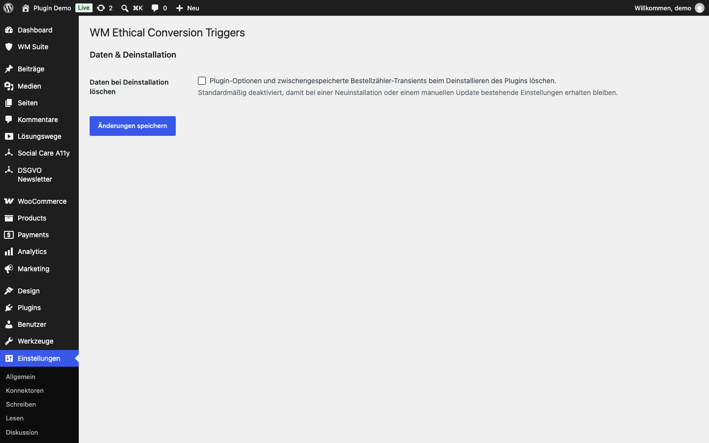
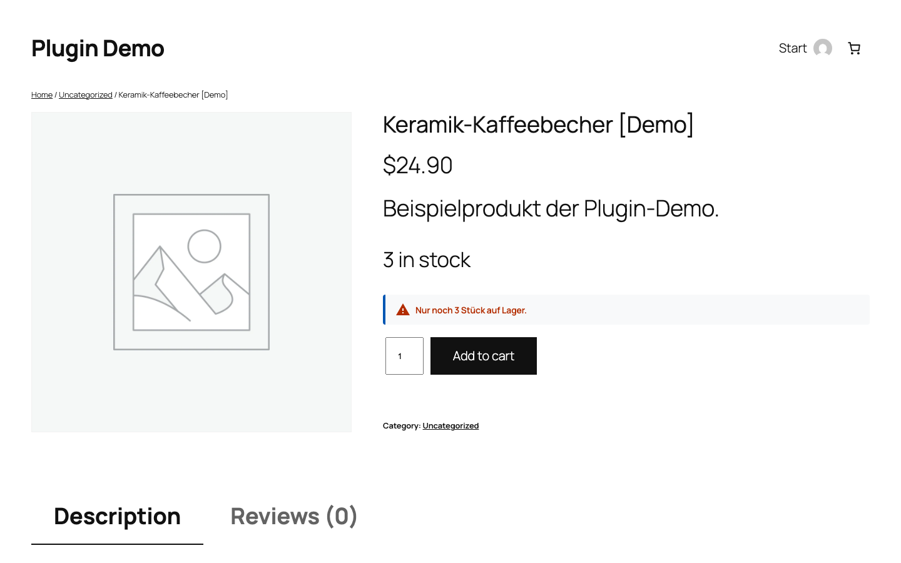

# WM Ethical Conversion Triggers (Documentación en Español)

<p align="center">
  <a href="README.md"></a>
  <a href="README.de.md"></a>
  <a href="README.es.md"></a>
</p>

<p align="center">
  
  
  
  
  
</p>

> **Avisos de pedidos recientes y bajo stock en páginas de producto de WooCommerce, mostrados solo cuando el dato es real y verificable**  
> **Página del plugin:** [https://arnoldwender.com/es/plugins-wordpress/wm-ethical-conversion-triggers/](https://arnoldwender.com/es/plugins-wordpress/wm-ethical-conversion-triggers/)  
> **Desarrollado con un agentic workflow:** creado con agentes de programación de IA. Revísalo y pruébalo como cualquier código de terceros antes de usarlo en producción.  
> **Soporte y responsabilidad:** Cero soporte (Zero Support) — errores reproducibles únicamente en [GitHub Issues](https://github.com/arnoldwender/wm-wp-ethical-conversion-triggers/issues) · sin soporte privado · TAL CUAL («AS IS») / sin responsabilidad ([SUPPORT.md](SUPPORT.md))

Plugin de WooCommerce que muestra avisos de pedidos recientes y bajo stock **solo cuando el dato es real y verificable**. Diseñado para tiendas en mercados regulados como el alemán, donde inventar urgencia o existencias constituye competencia desleal (UWG § 5).

---

## Capturas en vivo

!Banner de WM Ethical Conversion Triggers

| Ajustes > Ethical Triggers | Ficha de producto WooCommerce |
|---|---|
|  |  |

---

## Qué hace exactamente

Dos avisos en la ficha de producto (`woocommerce_before_add_to_cart_form`), cada uno con una condición estricta para aparecer:

| Aviso | Se muestra solo si |
|---|---|
| *«N Bestellungen dieses Artikels in den letzten 7 Tagen.»* | `N > 0`: pedidos **pagados** distintos (estados de `wc_get_is_paid_statuses()`, *processing* y *completed* por defecto) que contienen el producto, sin reembolsos (`parent_id = 0`), consultados en `wc_order_product_lookup` + `wc_order_stats` (compatible con HPOS, sin postmeta) |
| *«Nur noch N Stück auf Lager.»* | WooCommerce **gestiona el stock** de ese producto (`get_manage_stock()`) y quedan entre 1 y el umbral configurado (5 unidades por defecto) |

Si no se cumple ninguna de las dos condiciones, **no se emite nada** — ni siquiera el contenedor `<div class="wm-ect-container" aria-live="polite" role="status">`. Una región viva vacía se anuncia igualmente en lectores de pantalla, por lo que la guarda del render es exactamente la negación de lo que se pinta.

### Por qué la escasez solo aparece con stock gestionado

Si un producto no tiene gestión de stock activada en WooCommerce, no existe una cantidad verificable en almacén. En ese caso `Stock_Verifier::get_verified_stock()` devuelve `null` (nunca `0` ni un valor por defecto) y no se emite la línea de escasez.

---

## Idiomas incluidos

`languages/` incluye la plantilla `wm-ethical-conversion-triggers.pot` sincronizada con el código y **28 catálogos compilados** (`.po` y `.mo`): `ar`, `bg_BG`, `cs_CZ`, `da_DK`, `de_DE`, `el`, `en_GB`, `en_US`, `es_ES`, `et`, `fi`, `fi_FI`, `fr_FR`, `ga`, `hr_HR`, `hu_HU`, `it_IT`, `lt_LT`, `lv`, `mt_MT`, `nl_NL`, `pl_PL`, `pt_PT`, `ro_RO`, `sk_SK`, `sl_SI`, `sv_SE` y `tr_TR`.

---

## Requisitos

- WordPress 6.0 o superior
- PHP 8.0 o superior (`declare(strict_types=1)` en todos los componentes PHP)
- WooCommerce (declara compatibilidad con HPOS / *High-Performance Order Storage*). La cabecera incluye `Requires Plugins: woocommerce`; sin WooCommerce activo el plugin solo registra un aviso de error en la administración y el filtro del WM Suite Hub (el hub lo muestra entonces en `ERROR`).

---

## Instalación y desinstalación (D-UNINSTALL)

1. Copiar la carpeta `wm-ethical-conversion-triggers` en `wp-content/plugins/`.
2. Activar desde **Plugins**.
3. El aviso se inyecta automáticamente en la ficha de producto (`woocommerce_before_add_to_cart_form`).
4. En **Ajustes > Ethical Triggers** (`options-general.php?page=wm-ethical-conversion-triggers`) se ofrece la casilla opcional `wm_ethical_triggers_delete_data_on_uninstall` (desactivada por defecto, `'0'`). Al desinstalar el plugin, `uninstall.php` conserva las opciones y transients salvo que el administrador haya marcado explícitamente el borrado de datos.

---

## Extensibilidad e integraciones

- **Hooks para desarrolladores:**
  - `apply_filters( 'wm_ethical_triggers_config', array $config, int $product_id )` — permite ajustar `low_stock_threshold` (1–50, por defecto `5`), `enable_sales_notice` y `enable_stock_notice` sin romper los invariantes de stock gestionado ni pedidos pagados reales.
  - `do_action( 'wm_ethical_triggers_ready', \WMEthicalConversionTriggers\Plugin $plugin )` — se dispara en `init` tras inicializar el plugin con WooCommerce activo.
  - `do_action( 'wm_ethical_triggers_stock_updated', int $product_id, int $stock )` — se dispara cuando el webhook autenticado actualiza el inventario de un producto.
- **WordPress 6.5+ Block Bindings:** fuente `wm-ethical-triggers/metrics` compatible con bloques nativos (`key`: `summary`, `sales_notice` o `stock_notice`).
- **GenerateBlocks 2.x Dynamic Tag:** etiqueta dinámica `{{wm_ethical_trigger}}` registrada mediante `GenerateBlocks_Register_Dynamic_Tag`.
- **WM Suite Hub:** `Spoke_Adapter` (`includes/class-spoke-adapter.php`) implementa el `WM_Plugin_Module_Interface` del hub y entra en su lista de módulos por el filtro `wm_register_suite_module`, enganchado antes de la comprobación de WooCommerce:
  - estado: `ERROR` sin WooCommerce, `DEGRADED` si falta `{prefix}wc_order_product_lookup` o `{prefix}wc_order_stats`, si no `HEALTHY`;
  - telemetría (`YES`/`NO`): `woocommerce_active`, `analytics_tables`, `webhook_secret_configured`, `delete_data_on_uninstall`;
  - acción `self_test`: WooCommerce, las dos tablas, la regla de stock gestionado y que el webhook rechace una petición sin firma.

---

## Endpoint REST

`POST /wp-json/wm-ect/v1/stock-update`

Actualiza el stock gestionado de un producto desde un sistema externo (ERP o almacén):

- Requiere firma **HMAC-SHA256** en la cabecera `x-wc-webhook-signature`, codificada en base64 y comparada con `hash_equals()` en tiempo constante.
- El secreto se lee de la constante `WM_ECT_WEBHOOK_SECRET` (recomendado en `wp-config.php`) o de la opción `wm_ect_webhook_secret`. Sin secreto configurado el endpoint responde `500` y rechaza toda petición.
- Cuerpo JSON: `{"product_id": <int>, "stock_quantity": <int>}`.

---

## Rendimiento y Design Tokens

- El conteo de pedidos pagados se guarda en un transient por producto (`wm_ect_sales_<id>`) durante una hora y se invalida automáticamente en `woocommerce_update_product` y al recibir actualizaciones por webhook.
- `assets/css/ethical-triggers.css` define todas sus propiedades visuales como variables CSS en `:root` (`--wm-ect-*`) y carga únicamente recursos locales (sin CDN externos).

---

## Verificación y tests

```bash
php tests/test-suite.php
php tests/test-pot-freshness.php
bash tests/run-mutations.sh
python3 .github/scripts/security-audit.py
```

---

## Estructura

```text
wm-ethical-conversion-triggers/
├── wm-ethical-conversion-triggers.php   # cabecera, constantes, activación y arranque
├── uninstall.php                        # limpieza opt-in al desinstalar (D-UNINSTALL)
├── bom.json                             # SBOM CycloneDX 1.6 (GPL-2.0-or-later)
├── llms.txt                             # resumen legible por modelos
├── includes/
│   ├── class-plugin.php                 # singleton + registro de hooks
│   ├── class-frontend.php               # cálculo y render de avisos verificados
│   ├── class-stock-verifier.php         # consultas preparadas HPOS + caché transient
│   ├── class-webhook-validator.php      # ruta REST + validación HMAC-SHA256
│   ├── class-settings.php               # ajuste opt-in de borrado al desinstalar
│   ├── class-integrations.php           # filtro del Suite Hub, Block Bindings y GenerateBlocks
│   └── class-spoke-adapter.php          # módulo del Suite Hub: estado, telemetría, SBOM y self_test
├── assets/                              # CSS con Design Tokens (:root) y JS local
├── languages/                           # plantilla .pot + 28 catálogos .po/.mo
├── tests/                               # suite unitaria, frescura POT y mutaciones
└── .github/workflows/ci.yml             # CI en PHP 8.0 / 8.2 / 8.3
```

---

## Licencia

Distribuido bajo licencia **GPLv2 or later** (`GPL-2.0-or-later`). Consulta [LICENSE](LICENSE) y la cabecera de `wm-ethical-conversion-triggers.php`.
