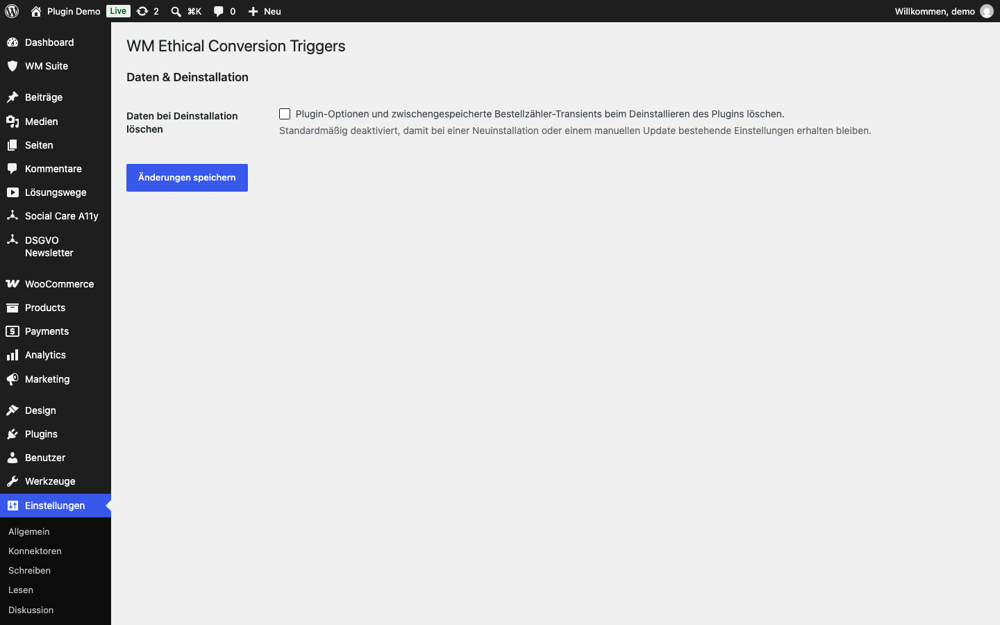
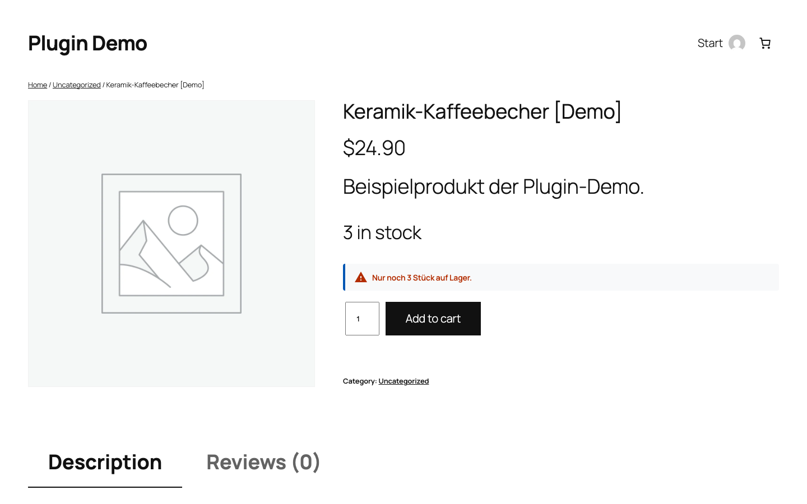

# WM Ethical Conversion Triggers

<p align="center">
  <a href="README.md"></a>
  <a href="README.de.md"></a>
  <a href="README.es.md"></a>
</p>

<p align="center">
  
  <a href="https://wordpress.org"></a>
  <a href="https://php.net"></a>
  
  <a href="https://www.gnu.org/licenses/gpl-2.0.html"></a>
</p>

> **Order and low-stock notices for WooCommerce product pages, shown only when the number is real and verifiable from HPOS order lookup tables and WooCommerce-managed inventory**  
> **Plugin page:** [https://arnoldwender.com/wordpress-plugins/wm-ethical-conversion-triggers/](https://arnoldwender.com/wordpress-plugins/wm-ethical-conversion-triggers/)  
> **Built with an agentic workflow:** developed with AI coding agents. Review and test it like any third-party code before you use it in production.  
> **Support & Liability:** Zero support — reproducible bugs on [GitHub Issues](https://github.com/arnoldwender/wm-wp-ethical-conversion-triggers/issues) only · no private support · AS IS / no liability ([SUPPORT.md](SUPPORT.md))

---

## Screenshots

!WM Ethical Conversion Triggers banner

| Settings > Ethical Triggers | WooCommerce Product Page |
|---|---|
|  |  |

---

## What the plugin does

Two notices on WooCommerce product pages (`woocommerce_before_add_to_cart_form`), each gated by a strict condition:

| Notice | Shown only when |
|---|---|
| *"%d Bestellung(en) dieses Artikels in den letzten 7 Tagen."* | `N > 0`: distinct **paid** orders (`wc_get_is_paid_statuses()`, `processing` and `completed` by default) containing the product over the last 7 days, excluding refunds (`stats.parent_id = 0`), queried via prepared SQL from `{prefix}wc_order_product_lookup` and `{prefix}wc_order_stats` (HPOS compatible, no postmeta) |
| *"Nur noch %d Stück auf Lager."* | WooCommerce **manages stock** for that product (`get_manage_stock()`) and `1 <= stock <= threshold` (`5` by default, configurable `1..50` via filter) |

When neither condition holds, **nothing is emitted** — not even `<div class="wm-ect-container" aria-live="polite" role="status">`. An empty live region is still announced by screen readers, so the render guard in `Frontend::render_ethical_trigger()` is the exact negation of what is rendered.

### Why scarcity is shown only with managed stock

If a product does not have stock management enabled in WooCommerce, there is no verifiable warehouse quantity. In that case `Stock_Verifier::get_verified_stock()` returns `null` (never `0` or a fallback value) and the low-stock line is omitted. Inventing urgency or stock counts constitutes unfair competition in regulated markets such as Germany (UWG § 5).

---

## Languages included

`languages/` ships `wm-ethical-conversion-triggers.pot` synchronized with the PHP source strings and **28 compiled gettext catalogs** (`.po` and `.mo`): `ar`, `bg_BG`, `cs_CZ`, `da_DK`, `de_DE`, `el`, `en_GB`, `en_US`, `es_ES`, `et`, `fi`, `fi_FI`, `fr_FR`, `ga`, `hr_HR`, `hu_HU`, `it_IT`, `lt_LT`, `lv`, `mt_MT`, `nl_NL`, `pl_PL`, `pt_PT`, `ro_RO`, `sk_SK`, `sl_SI`, `sv_SE`, and `tr_TR`.

---

## Requirements

- WordPress 6.0 or higher
- PHP 8.0 or higher (`declare(strict_types=1);` across all PHP files)
- WooCommerce active (declares HPOS / High-Performance Order Storage compatibility via `FeaturesUtil::declare_compatibility( 'custom_order_tables', ... )`). The plugin header declares `Requires Plugins: woocommerce`; without the `WooCommerce` class loaded (`Plugin::woocommerce_active()`), the plugin registers only an administrative error notice and the WM Suite Hub filter (the hub then lists it as `ERROR`), and `is_product()` / `wc_get_product()` calls stay behind `function_exists`.

---

## Installation & Opt-in Uninstall (`D-UNINSTALL`)

1. Copy `wm-ethical-conversion-triggers/` into `wp-content/plugins/` (with WooCommerce active).
2. Activate the plugin under **Plugins**. Product notices inject automatically at `woocommerce_before_add_to_cart_form`.
3. Under **Settings > Ethical Triggers** (`options-general.php?page=wm-ethical-conversion-triggers`, capability `manage_options`), the optional checkbox `wm_ethical_triggers_delete_data_on_uninstall` defaults to `'0'`. On plugin deletion, `uninstall.php` preserves plugin options and cached order-count transients unless the administrator explicitly opts into deletion.

---

## Extensibility & Integrations (`includes/class-integrations.php`)

- **Developer hooks:**
  - `apply_filters( 'wm_ethical_triggers_config', array $config, int $product_id )` — customizes `low_stock_threshold` (`1..50`, default `5`), `enable_sales_notice`, and `enable_stock_notice` without relaxing the managed-stock or paid-order invariants.
  - `do_action( 'wm_ethical_triggers_ready', \WMEthicalConversionTriggers\Plugin $plugin )` — fires on `init` once the plugin is initialized with WooCommerce active.
  - `do_action( 'wm_ethical_triggers_stock_updated', int $product_id, int $stock )` — fires after the authenticated webhook updates a product's managed stock.
- **WordPress 6.5+ Block Bindings:** registers source `wm-ethical-triggers/metrics` for core blocks (`key`: `summary`, `sales_notice`, or `stock_notice`, plus optional `product_id` or `postId` block context).
- **GenerateBlocks 2.x Dynamic Tag:** registers `{{wm_ethical_trigger}}` via `GenerateBlocks_Register_Dynamic_Tag` (`field`: `summary`, `sales_notice`, or `stock_notice`, with escaped output).
- **WM Suite Hub:** `Spoke_Adapter` (`includes/class-spoke-adapter.php`) implements the hub's `WM_Plugin_Module_Interface` and joins the hub's module list through the `wm_register_suite_module` filter, hooked before the WooCommerce check:
  - health: `ERROR` without WooCommerce, `DEGRADED` when `{prefix}wc_order_product_lookup` or `{prefix}wc_order_stats` is missing, otherwise `HEALTHY`;
  - telemetry (`YES`/`NO`): `woocommerce_active`, `analytics_tables`, `webhook_secret_configured`, `delete_data_on_uninstall`;
  - action `self_test`: WooCommerce, the two tables, the managed-stock rule and that the webhook refuses an unsigned request.

---

## REST Webhook Endpoint

`POST /wp-json/wm-ect/v1/stock-update`

Updates a product's WooCommerce-managed stock from an external ERP or warehouse system (`Webhook_Validator`):

- Requires a base64-encoded **HMAC-SHA256** signature in the `x-wc-webhook-signature` header, compared in constant time via `hash_equals()`.
- Reads the shared secret from the `WM_ECT_WEBHOOK_SECRET` constant (recommended in `wp-config.php`) or the `wm_ect_webhook_secret` option. When no secret is configured, the endpoint returns HTTP `500` (`missing_secret`) and refuses every request.
- JSON body: `{"product_id": <int>, "stock_quantity": <int>}`. Invalid signatures return `403`, missing signatures `401`, missing WooCommerce `501`, and unknown products `404`.

---

## Performance & Design Tokens

- Verified 7-day paid-order counts are cached per product in a 1-hour transient (`wm_ect_sales_<id>`) and invalidated on `woocommerce_update_product` and webhook stock updates.
- `assets/css/ethical-triggers.css` defines all visual properties as `:root` CSS custom properties (`--wm-ect-*`) and loads only local plugin assets (Zero-CDN; no external requests).

---

## Verification & Tests

```bash
php tests/test-suite.php
php tests/test-pot-freshness.php
bash tests/run-mutations.sh
python3 .github/scripts/security-audit.py
```

---

## Structure

```text
wm-ethical-conversion-triggers/
├── wm-ethical-conversion-triggers.php   # header, HPOS declaration, constants, activation & boot
├── uninstall.php                        # opt-in cleanup on uninstall (D-UNINSTALL)
├── bom.json                             # CycloneDX 1.6 SBOM (GPL-2.0-or-later)
├── llms.txt                             # machine-readable plugin summary
├── includes/
│   ├── class-plugin.php                 # singleton, WooCommerce guard & hook wiring
│   ├── class-frontend.php               # verified notice calculation & live-region guard
│   ├── class-stock-verifier.php         # prepared HPOS order lookup & transient cache
│   ├── class-webhook-validator.php      # wm-ect/v1/stock-update REST route & HMAC-SHA256 check
│   ├── class-settings.php               # Settings > Ethical Triggers opt-in uninstall screen
│   ├── class-integrations.php           # WM Suite Hub filter, Block Bindings & GenerateBlocks 2.x
│   └── class-spoke-adapter.php          # WM Suite Hub module: health, telemetry, SBOM entry, self_test
├── assets/                              # local Design-Token CSS (:root) and JS
├── languages/                           # .pot template + 28 .po/.mo locale packs
├── tests/                               # standalone suite, POT freshness & mutation checks
└── .github/workflows/ci.yml             # CI matrix on PHP 8.0 / 8.2 / 8.3
```

---

## License

Distributed under the **GNU General Public License v2 or later** (`GPL-2.0-or-later`). See [LICENSE](LICENSE) and the header of `wm-ethical-conversion-triggers.php`.
